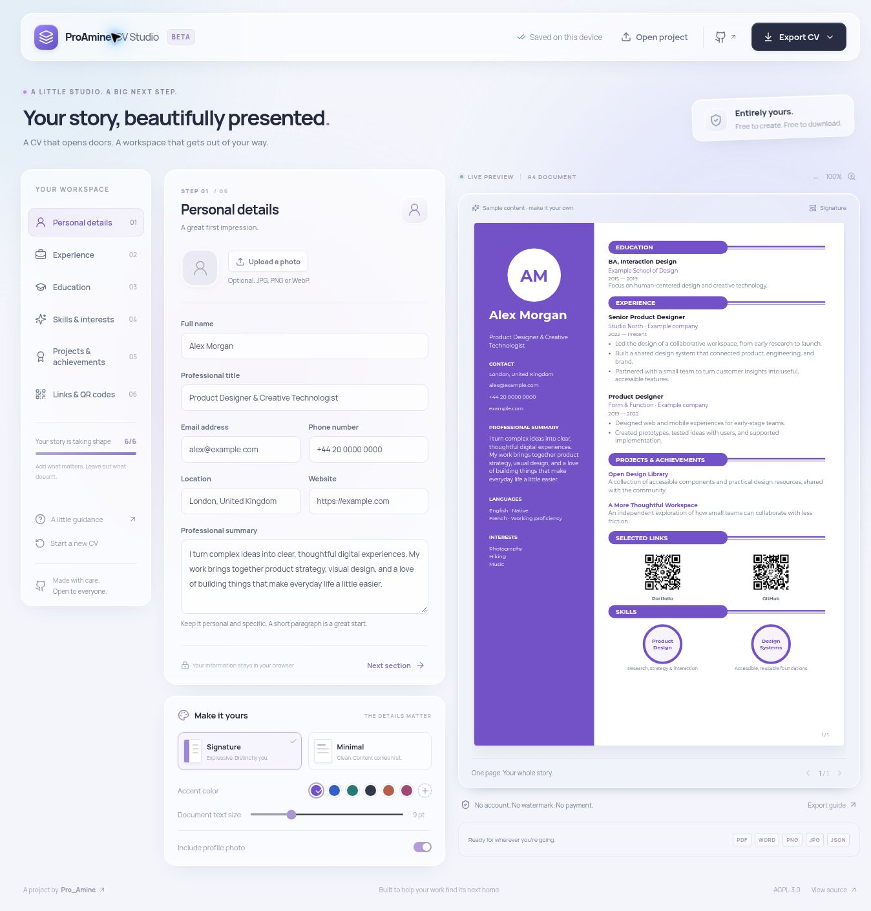

# ProAmineCVStudio

A free, open-source CV builder by **Pro_Amine**. Shape your story in a frosted-glass workspace, see the document update as you type, and download it without an account, payment, or watermark.



## What you can do

- Edit personal details, a professional summary, experience, education, skills, languages, interests, projects, and achievements.
- Choose **Signature**, a visual two-column CV inspired by the creator's Word design, or **Minimal**, a simple single-column alternative.
- Change the accent color and document text size, upload a circular profile photo, and add or remove entries.
- Add labeled HTTP(S) links to portfolios, repositories, profiles, products, or public documents. Generate black-and-white QR codes with optional center icons.
- Preview A4 pages with automatic continuation for longer content.
- Save on the current device, download a portable JSON backup, and reopen that backup later.

## Exports

| Format                  | What you receive                                                                                                                     |
| ----------------------- | ------------------------------------------------------------------------------------------------------------------------------------ |
| PDF                     | All pages, embedded fonts, selectable text, clickable links, and the preview's layout.                                               |
| Editable Word (`.docx`) | Native editable text, a colored sidebar for Signature, editable skill circles, QR images, hyperlinks, and embedded Montserrat fonts. |
| PNG / JPG               | Every A4 page at 2480 × 3508 pixels. Multiple pages are packaged in a ZIP.                                                           |
| JSON                    | All project fields, appearance settings, links, and the uploaded photo, ready to reopen in the app.                                  |

PDF and image exports share the preview's pagination. Word is a separate editable document: line wrapping, pagination, and some styling can vary between Word, LibreOffice, and other editors. The reference CV is an inspiration for the template, not a publicly distributed copy of the owner's personal document.

The bundled PDF font supports Latin and Cyrillic text. If your text includes a writing system or symbol outside that font, the app explains the limitation instead of silently dropping characters. Use **Print / Save PDF** with your browser's **Save as PDF** option, or export Word. Review the result before sharing. A dedicated right-to-left template is not included in this release.

QR codes use high error correction and a four-module white margin. Very long links may exceed QR capacity; shorten the link or switch QR codes off. JSON backups remain available. Scan the exported codes before printing, and make sure linked documents are accessible to the intended reader. Skill circles are decorative labels, not proficiency measurements.

## Privacy

The app has no account system, analytics, document-upload endpoint, AI service, or backend database. Editing, photo processing, QR generation, and exports happen in the browser. Fonts and application dependencies are hosted with the app.

Project data is saved in this browser's local storage, which can be cleared or unavailable. Keep JSON backups, especially before starting a new CV or switching devices. A downloaded JSON file includes your photo and personal details. Invalid saved data is preserved for recovery before the app replaces it.

The hosting provider receives ordinary requests for the app and its assets. Following a link or scanning a QR opens the destination chosen by the CV author.

## Run locally

Use Node.js 22 or newer and npm:

```sh
npm ci
npm run dev
```

```sh
npm test
npm run build
npm run preview
```

The production build is written to `dist/`. Vite uses relative asset paths so the app can run beneath a GitHub Pages repository path. No API keys, credentials, or paid services are required.

## Publish with GitHub Pages

1. Open the repository's **Settings → Pages**.
2. Under **Build and deployment → Source**, select **GitHub Actions**.
3. Open **Actions → Build and deploy CV Studio → Run workflow**, or push a commit to `main`.

The workflow runs the tests and production build before publishing. The repository's initial Pages configuration must be enabled by an administrator; the default workflow token does not create that configuration. Build artifacts can still be verified before the publishing step is enabled. Pull requests run the checks without deploying.

## Development

This is a static React and TypeScript application built with Vite.

| File                           | Responsibility                                                                       |
| ------------------------------ | ------------------------------------------------------------------------------------ |
| `src/model.ts`                 | Validated, versioned data, safe URLs, examples, and local storage.                   |
| `src/layout.ts`                | Wrapping, pagination, and shared document drawing operations.                        |
| `src/CvCanvas.tsx`             | SVG document preview and image rendering.                                            |
| `src/qr.ts`                    | QR data and center icons.                                                            |
| `src/exports.tsx`              | Vector PDF, editable Word, images, and project backups.                              |
| `src/App.tsx`, `src/style.css` | Editor, appearance controls, responsive glass interface, and reduced-motion support. |

Read [the project skill](skills/cvstudio/SKILL.md) and [AGENTS.md](AGENTS.md) before changing document layout or export behavior. Tests cover data portability and recovery, long-content pagination, safe links, QR errors, PDF metadata and links, and native Word content. Browser and rendered-document checks are also needed for visual changes.

Demonstration data is fictional. Do not commit real CVs, personal photos, exported user projects, credentials, or private documents.

## License and acknowledgments

Source code is available under the [GNU Affero General Public License v3.0](LICENSE). Keep the license and attribution when redistributing or modifying the software, and read the full license for its requirements.

The application uses React, Vite, TypeScript, Lucide, Zod, QRCode, pdf-lib, fontkit, docx, JSZip, and Manrope. Montserrat is bundled under the [SIL Open Font License](public/fonts/OFL.txt). See [third-party notices](THIRD_PARTY_NOTICES.md).
